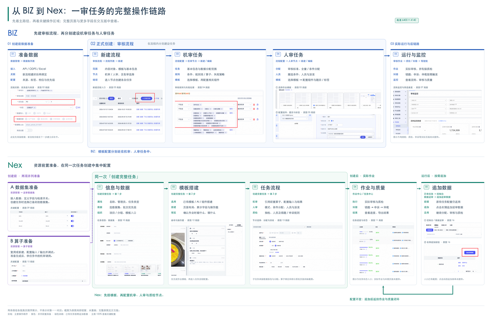

# BIZ 与 Nex 全链路操作对照

[打开交互讲解版](https://woaizou-eng.github.io/biz-nex-operations-guide/) · [打开紧凑静态大图](https://woaizou-eng.github.io/biz-nex-operations-guide/static.html)

## 文件与修改

- `index.html`：交互讲解版，点击节点看原始操作截图。
- `static/full-chain.png`：6400 × 4140 高清静态图。
- `static/full-chain.svg`：可编辑文字与布局的矢量源图，内嵌原始截图。
- `assets/`：16 张完整原始操作截图。
- `src/`：交互页文字、版式与交互源文件。

修改 `src/` 后运行 `node build.mjs`，提交生成的 `index.html`；GitHub Pages 从 main 分支根目录发布。构建不需要第三方依赖。

页面中的“编辑文字”只改当前浏览器内容；“保存修改副本”会按需打包全部原图，下载可离线继续编辑的 HTML，不会直接更改线上版本。

两条链路分别展示实际操作顺序，不表示平台对象一一对应。截图用于说明操作入口，来自不同业务示例。
